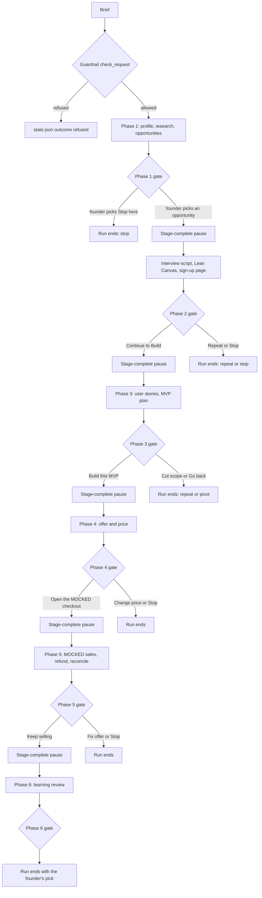
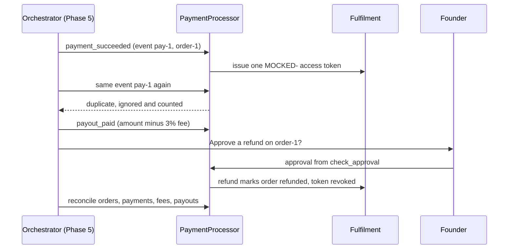
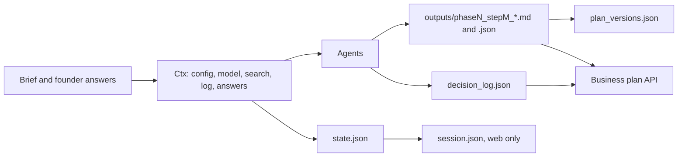

# Architecture

## Overview

Boardroom is one Python function, `run_pipeline` in `api/orchestrator.py`, that calls small agents in a fixed order. Our code owns the loop. Each model call returns JSON that a Pydantic schema checks. Four agents exist: Profiler, research intern, boss and co-founder (`api/agents/`). Phases 1 to 3 call the model. Phases 4 to 6 make no model calls; their money steps are MOCKED. Each gate makes a recommendation in code, and the founder then picks an option and gives a reason. The run follows the founder's pick, not the recommendation. The web API (`api/app.py`) and the CLI (`api/cli.py`) run the same pipeline.

**Every draft step** goes through `_reviewed`. The intern drafts. The boss runs code checks first: banned phrases, reading grade above 8, too many em dashes (`api/slop_check.py`), and the ethics check (`api/ethics.py`). Only if those pass does the boss model vote pass or fail. On a fail, the intern redrafts once with the boss's notes. If the ethics check blocks the second draft, the draft is saved as `phaseN_stepM_rejected_draft.md` and the run stops. If the second draft only fails review, the boss notes are added to the file and the run goes on. For the Lean Canvas, the founder also sees a warning and the log gets `warn_canvas_failed_review`.

**Stage-complete pause** (`level_up`): after the founder picks the "go" option at gates 1 to 5, the web run pauses. The founder can chat with the co-founder (up to 30 messages, each checked by the guardrail first) or press move on (`POST /runs/{id}/next`). Moving on logs `move_to_next_stage` with `approved_by: founder`. CLI and scripted runs skip this pause.

**Paused runs:** if the founder gives no usable answer after 3 tries, or the answers run out, the run saves outcome `paused` and logs `pause_run`.

## Phases

### Phase 1: Discover

- **Agents:** Profiler, co-founder, research intern, boss.
- **Tools:** Ollama model, SearXNG web search (`api/research.py`), source cards with a trust level (low for forums and social posts).
- **Method:** the Profiler asks only the questions the brief leaves open (at most 5 in demo mode, 30 in full). It writes the profile, including a co-founder type. The type is saved but the per-type prompts in `prompts/` are not wired in yet; chat uses `prompts/cofounder_base.md`. The intern plans 1 to 3 searches, then drafts 2 or 3 opportunities. It may cite only URLs the search returned; any other URL is removed and the claim is labelled `ASSUMPTION`. An opportunity counts as sourced only with a medium or high trust source. Founder fit (1 to 5) is the model's score for the weakest option. After the gate and the pause, the intern writes 5 interview questions about past behaviour (Mom Test) from `templates/interview_script.md`. Code swaps any "would you buy" question for a template question.
- **Output:** `phase1_step1_founder_profile.json`, `phase1_step2_opportunities.md`, `phase1_step2_sources.json`, `phase1_gate_decision.md`, `phase1_step3_interview_script.md`.

### Phase 2: Validate

- **Agents:** research intern, boss, co-founder.
- **Tools:** Ollama model, the source cards from Phase 1, the slop and ethics checks.
- **Method:** the founder writes their unfair advantage. The intern fills Lean Canvas boxes 1 to 8; box 9 is the founder's own words. Code builds the sign-up page from the canvas. If the page fails the ethics check, publishing is not offered. Otherwise the founder picks "Publish" or "Keep it private". Publish writes the page to disk only (STUBBED). The founder then enters the real sign-up count.
- **Output:** `phase2_step1_lean_canvas.md`, `phase2_step1_sources.json`, `phase2_step2_signup_page.md` (only if the founder chose Publish), `phase2_gate_decision.md`.

### Phase 3: Build

- **Agents:** research intern, boss.
- **Tools:** Ollama model, the source cards from Phase 1 (no new web search), the slop and ethics checks in the boss review.
- **Method:** the intern writes 5 to 8 user stories. Each has 1 to 4 acceptance criteria, a priority (must, should or could, at least one must), an hours guess and the smallest manual way to deliver it. It then writes a 2-week MVP plan for the must stories: what not to build, free tools, a checklist, the first 10 users and one number to watch. Weekly hours come from the profile limits; if none are given, code assumes 5 and says so.
- **Output:** `phase3_step1_user_stories.md`, `phase3_step1_sources.json`, `phase3_step2_mvp_spec.md`, `phase3_step2_sources.json`, `phase3_gate_decision.md`.

### Phase 4: Commercial setup

- **Agents:** co-founder. No model call.
- **Tools:** a fixed offer template in code, the ethics check (`api/ethics.py`).
- **Method:** the founder enters a price in EGP. Code writes the offer from a fixed template: who it is for, the price, a 7-day refund policy, no promised results, MOCKED checkout, and the price marked `ASSUMPTION`. The ethics check reads it.
- **Output:** `phase4_step1_offer.md`, `phase4_gate_decision.md`.

### Phase 5: Sell, deliver, get paid

- **Agents:** co-founder. No model call. All money steps MOCKED.
- **Tools:** MOCKED `PaymentProcessor` (`api/payments.py`), `api/fulfilment.py`, `api/refunds.py`, `api/reconcile.py`.
- **Method:** the founder enters how many people said they would buy (at most 20). Code runs that many test orders through `PaymentProcessor` (see Sale to cash), then asks the founder to approve or decline a refund on order-1.
- **Output:** `phase5_step1_sales_log.md`, `phase5_step2_reconciliation.md`, `phase5_gate_decision.md`.

### Phase 6: Operate and learn

- **Agents:** co-founder. No model call.
- **Tools:** the gate code in `api/gates.py`; all numbers are entered by the founder.
- **Method:** the founder enters how many buyers came back within 2 weeks and what buyers asked for most. Code writes a learning review with the gate's reading and one next experiment.
- **Output:** `phase6_step1_learning_review.md`, `phase6_gate_decision.md`.

## Gates

Gate code is in `api/gates.py`. Targets for gates 1 and 2 come from `config.yaml` and are set before the run. Each gate writes `phaseN_gate_decision.md` (target, result and where it came from, recommendation, the options shown, the founder's pick and reason) and logs `phaseN_gate` with its outcome. The founder then picks an option and gives a reason; that is logged as `phaseN_decision` with `approved_by: founder`.

| Gate | Checks (from code) | Outcomes |
|---|---|---|
| 1 Discover | Sourced problems, target 3. Founder fit, target 3 of 5. Reach = number of groups in the profile. | 0 sourced: stop. Reach 0: stop. Both weak: stop. Fit weak: pivot. Sources weak: repeat. Else go. |
| 2 Validate | Founder-entered sign-ups against 100 in 14 days. | 100 or more: go. 30 to 99: repeat. Under 30: stop. |
| 3 Build | Must-story hours (model guess) against 2 weeks of the founder's hours. | Fits: go. Too big: repeat (cut scope). |
| 4 Commercial | Price above 0 and the offer passed the ethics check. | Both: go. Else repeat. |
| 5 Sell | At least 1 paid MOCKED order and 0 reconciliation mismatches. | Both: go. Else repeat. |
| 6 Operate | Buyers who came back, as a share of paid buyers. | 40% or more: go. 15% to 39%: repeat. Under 15%: pivot. No paid buyers: stop. |

**When STOP is recommended on weak evidence:** Phase 1 says stop when no problem has a medium or high trust source, when the founder names no group they can reach, or when sources and fit are both under target. Phase 2 says stop under 30% of the sign-up target. Phase 6 says stop with no paid buyers. Every gate also offers the founder a stop option.

**Founder approval in code** (`api/approval.py`): `check_approval` needs an option from the list and a reason. The reason must not be a filler answer like "yes" or "ok", must have 3 or more different real words, and must reach the word minimum (8 in demo mode, 15 in full mode). Only `check_approval` can make a valid `Approval`. `run_gated` and `@require_approval` refuse to run without one, and the log refuses a gated entry without the founder's words. `POST /runs/{id}/gate` runs `check_approval` too, before the answer reaches the pipeline.

**Guardrail** (`api/guardrail.py`): `check_request` reads the brief and refuses banned products (physical goods, financial, health or legal advice) and banned actions. `check_answer` reads every founder answer for banned actions. Rules come from patterns in code plus the table in `evals/trick_prompts.md`.

## Sale to cash

All MOCKED (`api/payments.py`, `api/fulfilment.py`, `api/refunds.py`, `api/reconcile.py`). No payment provider, no sandbox, no real money. Phase 5 runs this inside the pipeline.

- **Payment triggers delivery:** a `payment_succeeded` event for a new order records the payment and issues one access token. Nothing is emailed or sent.
- **Idempotency:** a repeated `event_id` is ignored and counted as a duplicate. A second payment for an order that is already paid does not deliver again.
- **Refund revokes access:** in the pipeline a refund runs only through `request_refund`, which needs a founder `Approval`. It marks the order refunded and turns off its token. A declined refund is logged as `keep_order`. The processor also accepts a mock provider `refunded` event.
- **Reconciliation:** for each paid order, code checks payment against order amount, fee against 3%, and payout against payment minus fee. It lists `amount_mismatch`, `fee_mismatch`, `missing_payout` and `payout_mismatch`. A refunded order needs no payout.
- **Log:** every step goes to `decision_log.json` with MOCKED in the outcome. A founder refund carries `approved_by: founder`.
- **Standalone test:** `python3 scripts/payment_test.py` runs 3 orders (a duplicate webhook, a wrong fee, a missing payout, a founder refund) and writes `outputs/payment_test_log.md`.

## Data flow

1. Each run has its own folder (`runs/<id>/`). The CLI and the web API both build one `Ctx` and pass it to every agent.
2. Agents get the profile JSON, the chosen opportunity and earlier drafts as text. Search results and the brief are wrapped as untrusted data.
3. `ctx.output(phase, step, name)` writes `outputs/phase<N>_step<M>_<name>.<ext>`. Gates write `outputs/phase<N>_gate_decision.md`.
4. `DecisionLog` appends one entry per action with `timestamp, agent, action, sources, model, cost, approved_by, founder_input`, plus tokens, outcome or reasons when present. Model calls log the model name and cost 0.
5. `state.json` holds the current step, the outcome and each gate's result. `plan_versions.json` keeps up to 50 plan snapshots, one per draft or decision. The web app also writes `session.json` with what the screen shows and the founder's answers, never keys.
6. `api/plan.py` builds the living business plan only from these files (`GET /runs/{id}/plan`, `/plan.md`, `/plan/versions/{n}`).

## Built vs. stubbed

Kept in sync with the README table.

| Part | Status |
|---|---|
| Phase 1: intake, research with sources, opportunities, gate, interview script; Lean Canvas with the failed-review warning | Working (committed demo run on a free open-weight model) |
| Sign-up page and Phase 2 gate with STOP | STUBBED (built and tested; not yet in a committed real run) |
| Phases 3 to 6 in the run, each with a stage-complete pause | STUBBED (built and tested with a scripted model; not yet in a committed real run) |
| Payment, delivery, refunds, reconciliation | MOCKED |
| Netlify publishing of the approved page (`api/publish.py`) | STUBBED (code and tests, never run against Netlify) |
| Founder approval in code | Working |
| Stage-complete screen: move on or chat with the co-founder | Working |
| Guardrail, ethics check, decision log | Working |
| Living business plan with version history | Working |
| Judges panel | STUBBED (no code yet, prompt file only) |
| Voice input and text to speech | STUBBED |

**Netlify:** `POST /runs/{id}/publish/netlify` puts the saved sign-up page online with the founder's own token. It refuses unless the log holds the founder's publish approval. The token is used for one request and never stored. `DELETE` on the same path takes the page down.

## Roadmap

1. Commit real runs through Phases 2 to 6.
2. Replace the MOCKED checkout with a payment provider's test mode.
3. Wire the five co-founder type prompts into chat.
4. Build the judges panel.
5. Arabic voice output.
