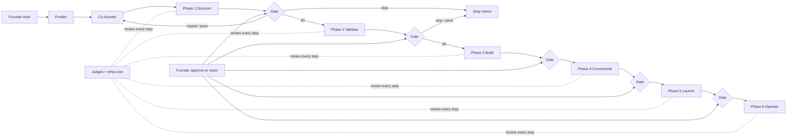

# Architecture

## Overview

Boardroom is a fixed workflow in plain Python with small agents at each step. Code decides the order of steps; models fill in each step and return JSON checked by a schema. The founder is at the center: a Profiler learns who they are, a co-founder agent with a personality matched to them leads the chat, and every gate needs the founder's choice and reason. Judges and an ethics bot review every step. Everything runs locally on an open-weight model through Ollama.

## Phases

Every step: an intern agent drafts from a template, a boss agent checks it (code checks first, then a pass/fail review), judges and the ethics bot review it, then a gate. Every claim has a source URL or the label `ASSUMPTION`.

### Phase 1: Discover

- **Agents:** Profiler, co-founder, research intern, research boss, marketing intern.
- **Tools:** local knowledge base (`kb/`), SearXNG web search, Ollama.
- **Method:** learn the founder first (skills, access, money, time, values, personality). Pick a co-founder type to cover their weak spots. Find 2–3 opportunities where the founder has an edge, using a beachhead score. Write a customer interview script from YC's "How to Talk to Users" and The Mom Test.
- **Output:** `phase1_step1_founder_profile.md`, `phase1_step2_opportunities.md`, `phase1_step2_sources.json`, `phase1_step3_interview_script.md`, `phase1_gate_decision.md`.

### Phase 2: Validate

- **Agents:** co-founder, research intern and boss, marketing intern and boss, shark panel.
- **Tools:** Lean Canvas template, landing page template.
- **Method:** fill the Lean Canvas with evidence or `ASSUMPTION` per box. Draft a landing page (not published without approval). Set a sign-up target before the test. The founder enters real numbers. A shark panel gives practice feedback, labelled SIMULATION.
- **Output:** `phase2_step1_lean_canvas.md`, `phase2_step2_landing_page.html`, `phase2_step3_shark_panel.md`, `phase2_gate_validation.md`.

### Phase 3: Build

- **Agents:** co-founder (user stories coach), builder.
- **Method:** the founder writes 3–5 user stories; the coach checks them against INVEST. The builder writes an MVP spec and tests, one test per acceptance criterion.
- **Output:** `phase3_step1_user_stories.md`, `phase3_step2_mvp_spec.md`.

### Phase 4: Commercial setup

- **Agents:** research intern and boss, ethics bot.
- **Method:** price from sourced comparisons. Draft terms, privacy, and refund policies marked "draft, not legal advice". The ethics bot checks for hidden fees and privacy gaps.
- **Output:** `phase4_step1_pricing.md`, `phase4_step2_policies.md`.

### Phase 5: Launch

- **Agents:** marketing intern and boss, ethics bot.
- **Method:** store page and launch posts, each approved by the founder before anything goes out. Payment and delivery are MOCKED (see Sale to cash).
- **Output:** `phase5_step1_store_page.html`, `phase5_step2_launch_posts.md`, `payment_test_log.md`.

### Phase 6: Operate and learn

- **Agents:** co-founder, judges.
- **Method:** support reply drafts, simple metrics, and a keep-going-or-change memo based on the evidence.
- **Output:** `phase6_step1_pivot_memo.md`.

## Gates

| Gate | Checks | Outcomes |
|---|---|---|
| Phase 1 | At least 3 sourced problems; founder-fit score at or above the bar; founder picks one option and explains why | go / repeat / pivot / stop |
| Phase 2 | Sign-up result against a target set before the test (example: 100 in 14 days); Lean Canvas boxes with real evidence | go / repeat / pivot / stop |
| Phase 3 | Tests pass | go / repeat |
| Phase 4 | Founder approval; ethics bot verdict recorded | go / repeat |
| Phase 5 | Founder approval of each post and the store page | go / repeat |
| Phase 6 | Founder approval of the memo | persevere / pivot / stop |

**When the system recommends STOP:** when a result is under 30% of its pre-set target, or when a gate decision would rest only on assumptions or low-trust sources. Targets live in `config.yaml` and can't be changed after results come in.

**Founder approval is enforced in code** (`approval.py`): an approval needs a chosen option and a reason of 15 words or more; "yes", "ok", and similar are rejected. Nothing is published, sent, spent, or signed without an approval record.

## Sale to cash

All MOCKED. Simulated events only: no real payments of any kind, not even sandbox. No money is held, moved or refunded.

- **Payment triggers delivery:** `api/payments.py` takes a mock `payment_succeeded` event keyed by `order_id` and `event_id`. `api/fulfilment.py` then issues one access token (prefix `MOCKED-`) for the digital product. Nothing is emailed or sent.
- **Idempotency:** a repeated `event_id` is ignored and counted. A second payment event for an order that is already handled does not deliver again.
- **Refund revokes access:** `api/refunds.py` marks the order refunded and disables its token. A refund starts only from a founder-approved request (`request_refund` checks `approval.py`) or a mock provider `refunded` event. The system never starts one on its own.
- **Reconciliation:** `api/reconcile.py` matches orders, payments, fees (expected 3 percent, MOCKED) and payouts. It lists `missing_payout`, `amount_mismatch`, `fee_mismatch` and `payout_mismatch`.
- **Log:** payment, delivery, refund and reconcile actions go to `decision_log.json` with MOCKED in the outcome; founder refunds carry `approved_by: founder`.
- **Test run:** `python3 scripts/payment_test.py` runs 3 orders (normal, duplicate webhook, refunded, with one missing payout and one fee mismatch) and writes `outputs/payment_test_log.md`.
- **Netlify publishing** (the approved sign-up page) lives in `api/publish.py`.

## Data flow

1. The founder brief and answers go into `founder_profile.json`.
2. Each step reads the profile summary, earlier step summaries, the last 3 decisions, the knowledge-base notes it needs, and the last 6 chat turns.
3. Agents write outputs to `outputs/` and append one entry per action to `decision_log.json` (`timestamp, agent, action, sources, model, cost, approved_by`, plus `founder_input`).
4. Decisions go to `decisions.md`; voice and typed notes to `notes.md`.
5. At each gate, a 5-line summary is saved to `run_state.json` so later steps stay small.

## Built vs. stubbed

Kept in sync with the README table. Updated only after a real run.

| Part | Status |
|---|---|
| Phases 1–2 pipeline: intake, research with sources, opportunity gate, interview script, Lean Canvas, sign-up page, sign-up gate with STOP | Working (committed demo run plus live runs on a free open-weight model) |
| Living business plan with version history | Working |
| Accelerator stage cards ("This week") | Working |
| Phases 3–6 agents | STUBBED |
| Payment and delivery (events, access tokens, refunds, reconciliation) | MOCKED |
| Netlify publishing of the approved page | STUBBED (code and tests, never run against Netlify) |
| Approval rules in code | Working |
| Guardrail, ethics check, decision log | Working |
| Judges panel | STUBBED |
| Voice input in the browser | STUBBED (built and unit-tested, not tried with a real microphone) |

## Roadmap

1. Finish Phases 3–6 end to end.
2. Arabic voice output.
3. More daily lessons and market notes (Egypt first, then nearby markets).
4. Optional hosted version with the same free core.
