# Boardroom

An open-source AI co-founder team that builds the founder as much as the business. It learns who the founder is first, plays to their strengths, and takes an idea through six gated phases toward a tested, sellable digital product. The founder makes every decision, and the system says **stop** when the evidence is weak. It runs free on a local open-weight model.

**Problem.** First-time founders, especially outside big startup hubs, start with an idea and no one to push back. They build for months before anyone pays, and the tools that help cost money they don't have. (ASSUMPTION, from our own experience and early conversations; not yet measured.)

**Who it is for.** A first-time founder with a skill and a group of people they can reach: a tutor with a WhatsApp group, a designer with a client list. Egypt first, in English or Arabic.

**Why open beats closed.** Every prompt, gate and threshold is a plain file you can read and change. It runs on a free open-weight model on your own laptop, so your idea and your answers stay with you. Anyone can fork it for their own market or language.

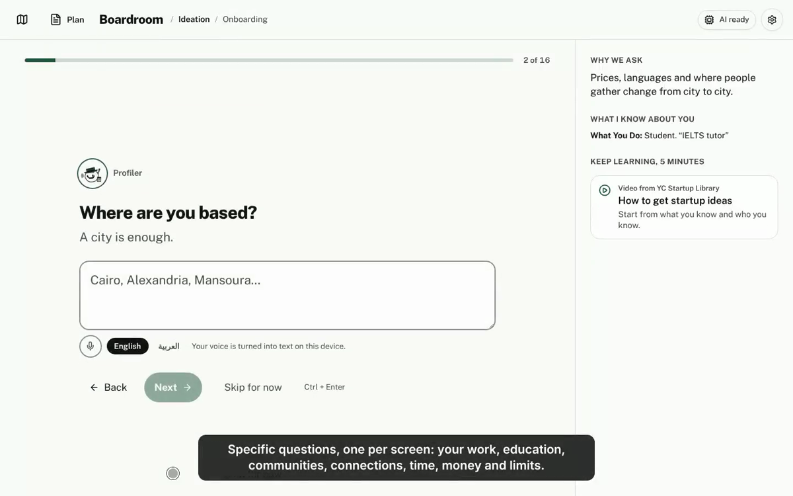

**How a run goes:** you answer short questions about your work, studies, groups and limits. You check the profile it built. A research intern finds problems with sources, a boss agent checks every draft, and at each gate you pick an option and say why in your own words. A bare "yes" never counts. Targets are set before each test, and weak results get a plain stop.

## Quickstart

```bash
docker compose up
```

Open http://localhost:3000. The first start downloads the local model, which takes a few minutes. Answer the onboarding questions (type, or use the mic button), then follow the co-founder through each gate. The Map and Plan buttons at the top are always there.

### How to use it

1. **Pick a model.** Click the model button (top right). Local models are free and private; a free hosted key works if your laptop is small.
2. **Answer the onboarding.** About 16 short screens, and you can skip any. Then check "Here's what I understood" and fix any line.
3. **Work through the six stages.** Ideation, Validation, Build, Commercial setup, Sell and get paid, Operate and learn. Answer the co-founder's questions. Each stage ends at a gate: pick an option and explain why in your own words.
4. **Stage complete.** After you pass the gate of stages 1 to 5, a "Stage complete" screen gives two buttons: go to the next stage, or keep talking with the co-founder. Nothing moves until you click.
5. **Watch the evidence.** Sources sit in the right panel with a trust level. Anything unsourced says `ASSUMPTION`. Checkout, payments and refunds in stages 4 and 5 are MOCKED and say so on screen.
6. **Open the Map or the Plan** any time. The Map shows all six stages. The Plan has the full business plan, open issues and version history.


### Every screen of one run

Captured by `tests/e2e/readme_shots.js` through the real app and API with the scripted test model, so every run looks the same. Real-model results are in `outputs/`.

| | |
|---|---|
| 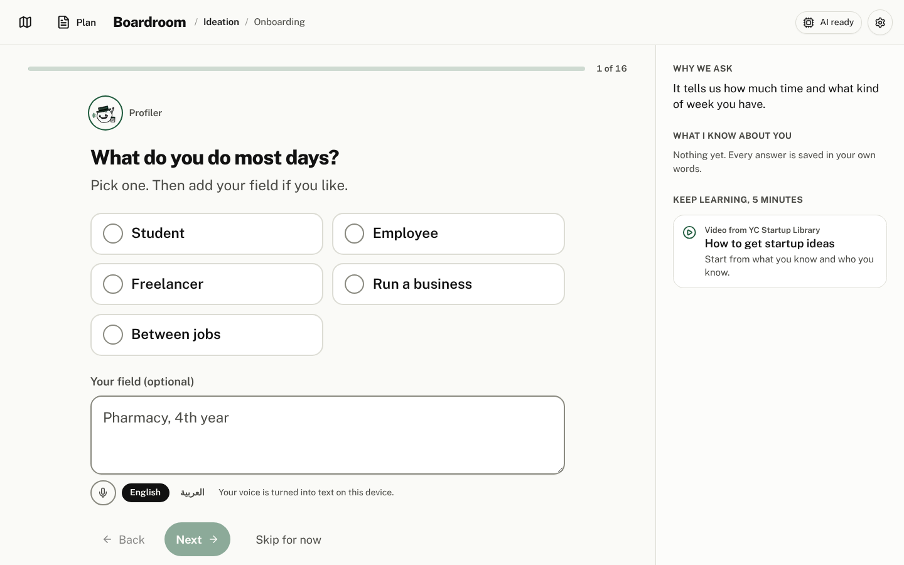<br>1. Onboarding: specific questions, one per screen, no model needed | 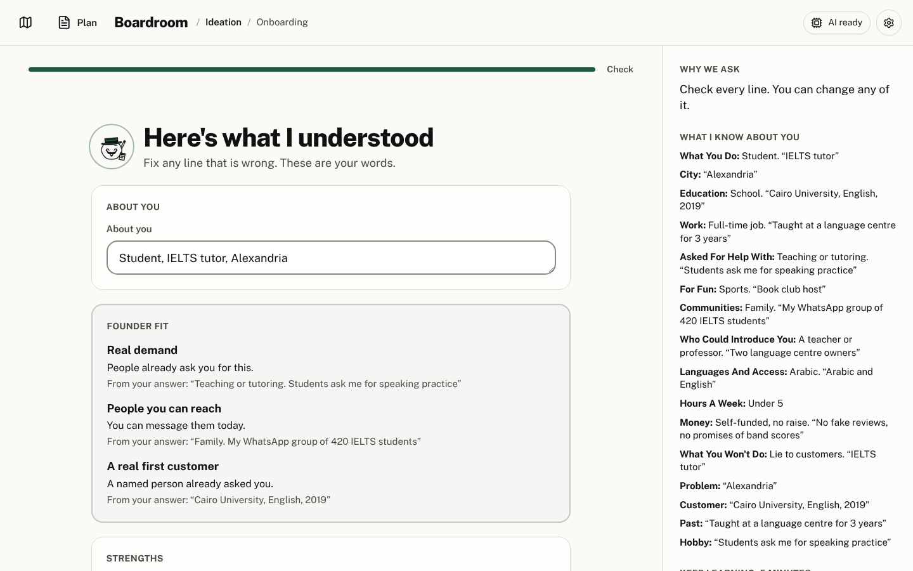<br>2. Check what it understood about you before anything starts |
| 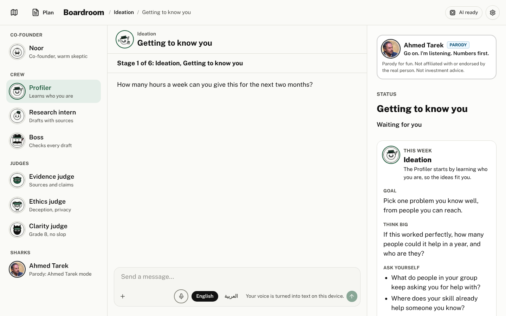<br>3. The co-founder asks only what is missing. The stage bar always shows where you are | 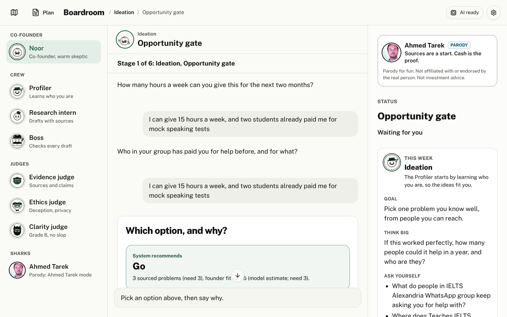<br>4. Ideation gate: options with sources, cost and risk, and a recommendation |
| 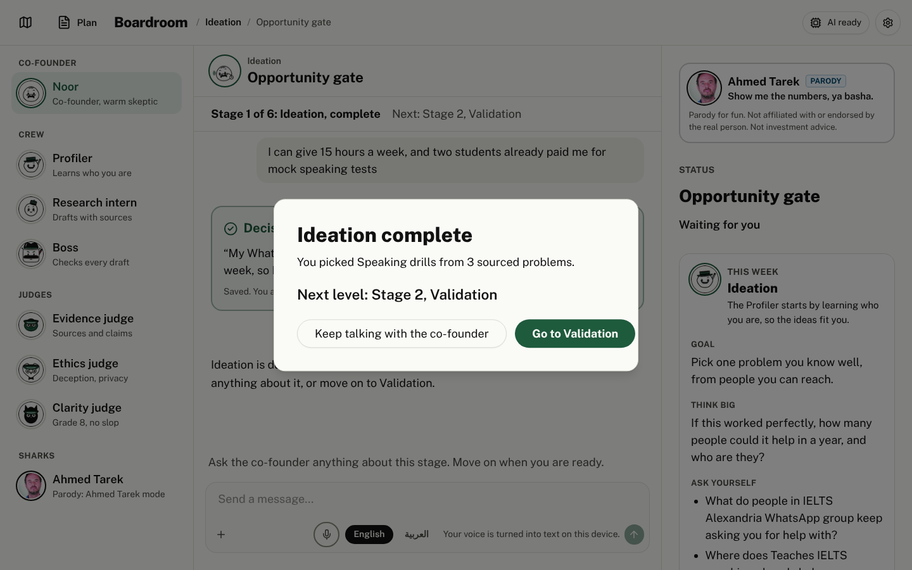<br>5. Stage complete: go to the next stage, or keep talking | 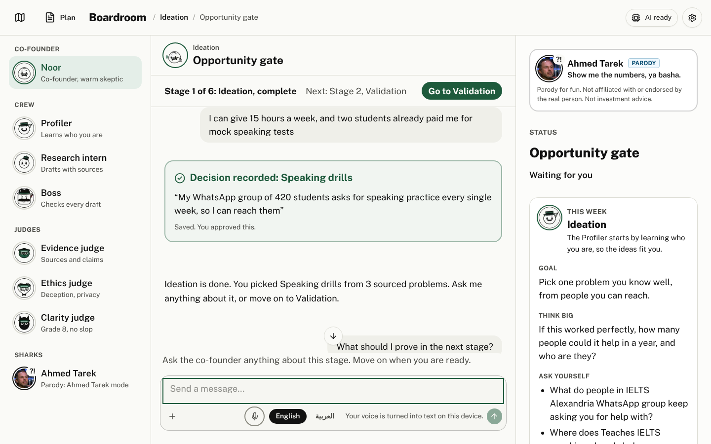<br>6. Keep talking: ask the co-founder anything before you move on |
| 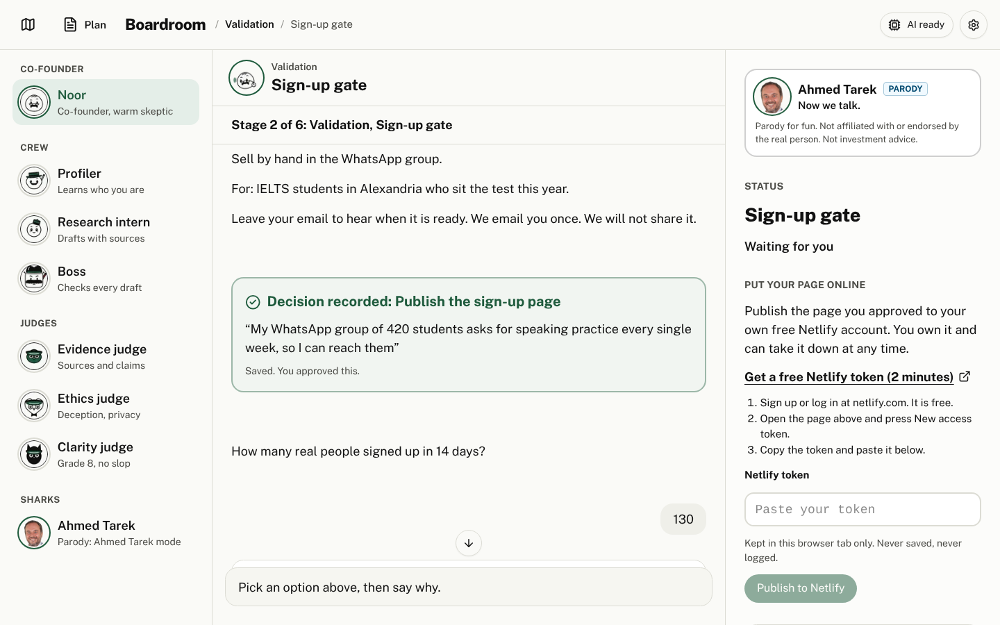<br>7. Validation gate: real sign-ups against a target set before the test | 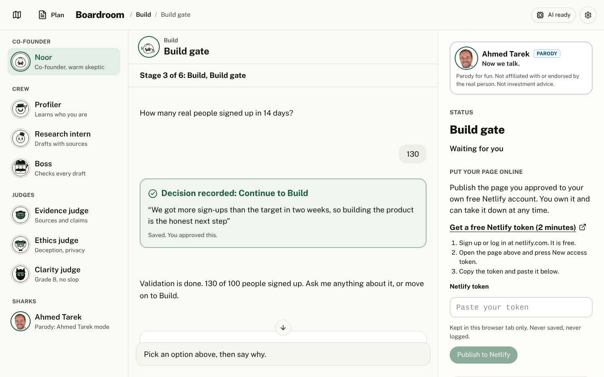<br>8. Build gate: user stories and a 2-week MVP plan checked against your hours |
| 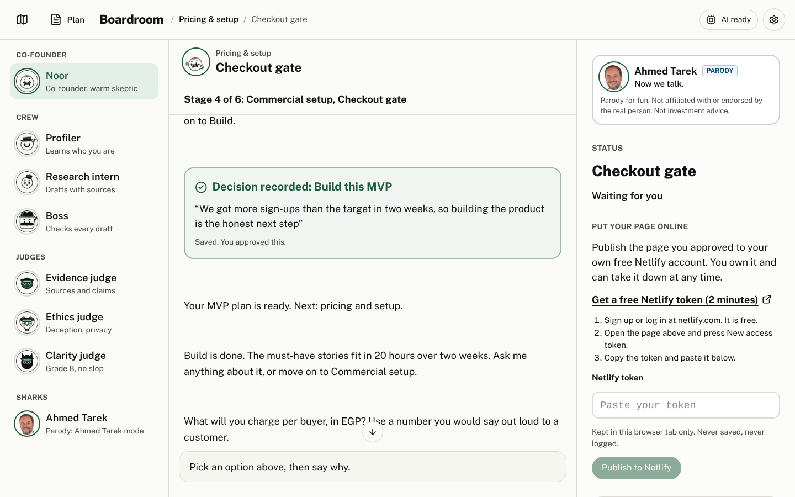<br>9. Commercial setup: offer, price and refund policy; checkout is MOCKED | 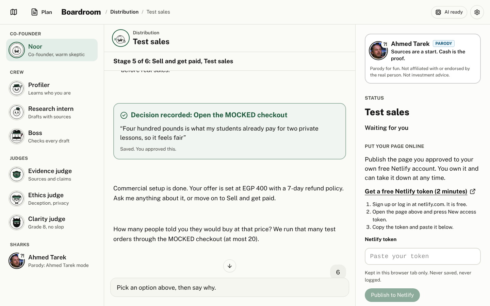<br>10. Sell: a refund only happens with your approval; no real money moves |
| 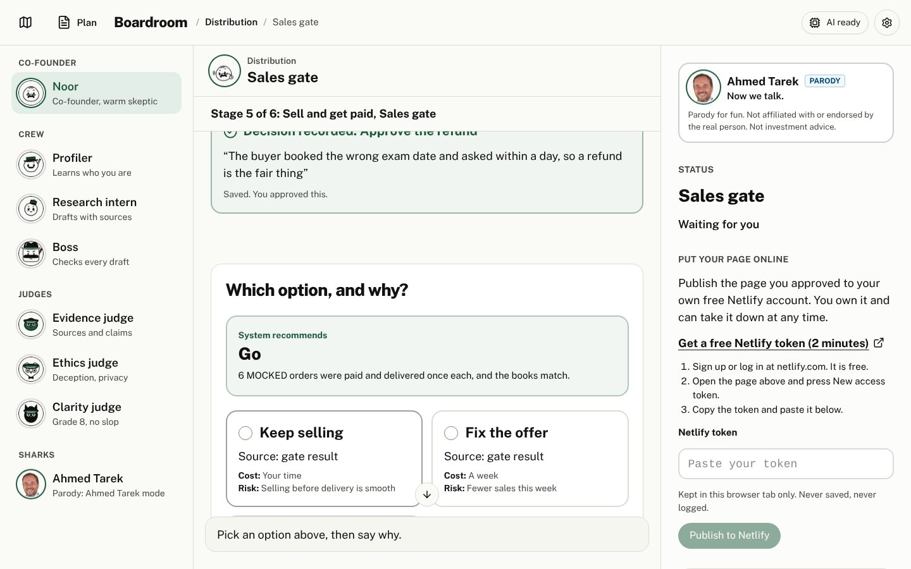<br>11. Sales gate: one delivery per payment, duplicate webhook ignored, books reconciled | 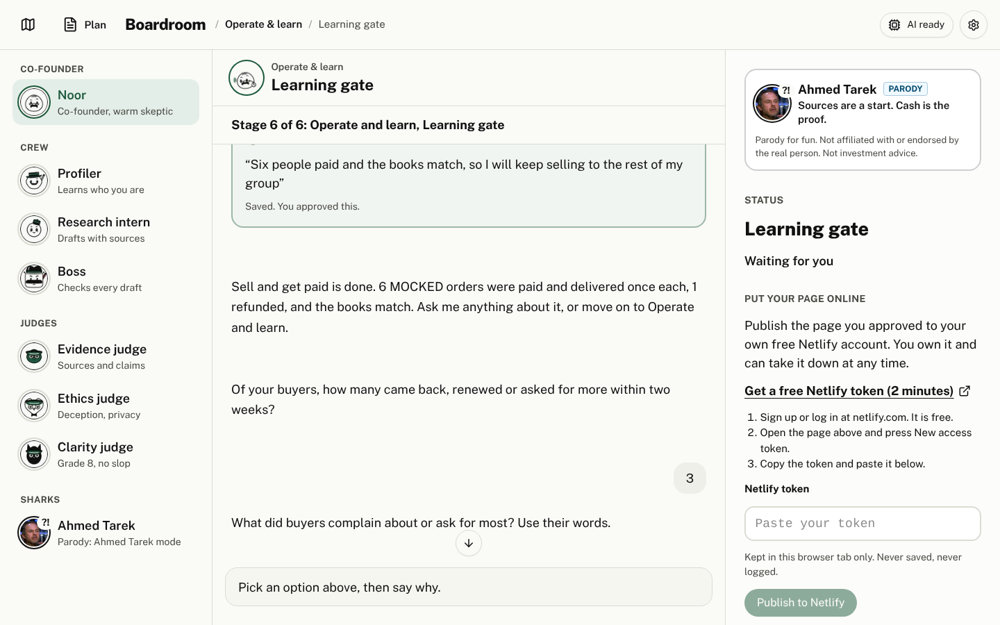<br>12. Operate and learn: repeat buyers decide keep, fix, pivot or stop |
| 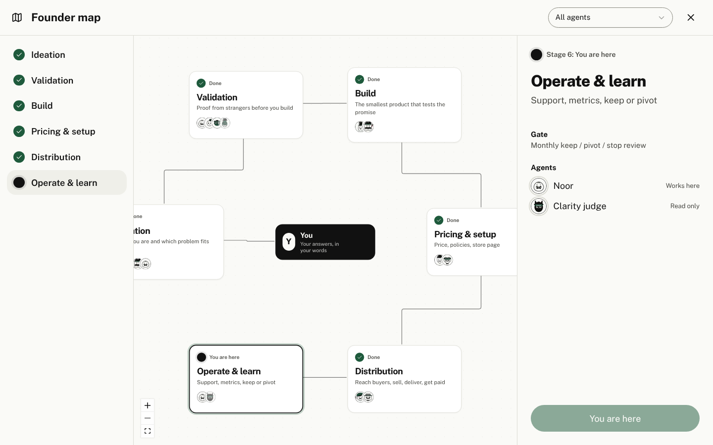<br>13. The founder map: look back at every stage | 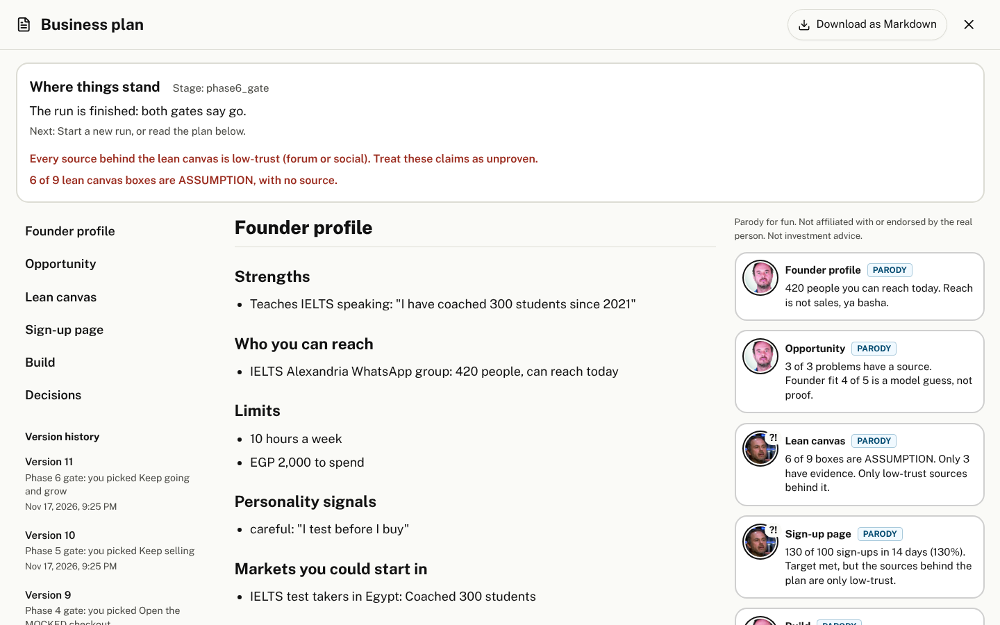<br>14. The living business plan with sources and version history |

In the terminal, with `docker compose up` still running for the model and search: `pip install -r requirements-dev.txt`, then `OLLAMA_URL=http://localhost:11434 SEARXNG_URL=http://localhost:8080 python3 -m api.cli --brief briefs/strong.md`. Swap in `--brief briefs/weak.md --answers briefs/weak_answers.yaml` to replay the founder answers of the weak-idea run that ends in stop.

## What works and what is mocked

Statuses are updated only after a real run. The committed run (`outputs/`, `decision_log.json`) went through all six stages on a free open-weight model, with founder answers replayed from `briefs/full_answers.yaml`. Working = tested end to end. MOCKED = simulated on purpose. STUBBED = designed, minimal output only.

| Phase | Step | Status |
|---|---|---|
| 1 Discover | Founder intake and profile | Working |
| 1 Discover | Find opportunities (research intern + boss) | Working |
| 1 Discover | Customer interview script | Working |
| 1 Discover | Gate: founder picks an option and explains why | Working |
| 1 Discover | STOP on a weak idea: the gate recommends stop when the founder can reach no one (real-model run: `outputs/phase1_gate_weak_idea_decision.md`) | Working |
| 2 Validate | Lean Canvas (boss review; a second failed review is shown as a warning) | Working |
| 2 Validate | Sign-up page draft and founder publish approval (page saved locally) | Working |
| 2 Validate | Publish sign-up page to Netlify (founder's own free account; code and tests only, never run against Netlify) | STUBBED |
| 2 Validate | Sign-up target gate (recommends stop under 30% of the target; founder enters the real count) | Working |
| 2 Validate | Shark panel (SIMULATION, one model call after the Lean Canvas; built and tested, not yet in a committed real run) | STUBBED |
| 3 Build | User stories, MVP spec and build gate (hours checked against the founder's time) | Working |
| 4 Commercial setup | Offer, price and refund policy, then a founder gate before the MOCKED checkout | Working |
| 5 Sell | Store page and launch posts (no code yet) | STUBBED |
| 5 Sell | Test orders in the run: payment triggers one delivery, duplicate webhook ignored, refund only with founder approval, reconciliation (no real money) | MOCKED |
| 5 Sell | Payment and automatic delivery (simulated events, access token, refunds, reconcile; no real money) | MOCKED |
| 6 Operate | Learning review from repeat buyers and feedback, then keep, fix, pivot or stop | Working |
| All | Founder approval enforced in code (no bare yes, option plus reason) | Working |
| All | Stage-complete screen after each stage: go to the next stage or keep talking with the co-founder | Working |
| All | Guardrail, ethics check and decision log | Working |
| All | Judges panel (no code yet, prompt file only) | STUBBED |
| Web | Voice input (speech to text in the chat box and onboarding; built and unit-tested, not yet tried with a real microphone) | STUBBED |
| All | Text to speech and voice in the Python pipeline | STUBBED |

## Architecture

A fixed workflow in plain Python runs the six phases. Each step is done by small agents: an intern drafts, a strict boss checks, and a code-based ethics check reads every page before it can be published. A judges panel is planned (STUBBED). Every model reply is JSON checked against a schema, and every agent action is appended to `decision_log.json`. A gate ends each phase: the founder chooses between options and explains why, and the gate code compares results to targets set in advance. Full design: [ARCHITECTURE.md](ARCHITECTURE.md).

## Models and free resources

- Model: `qwen3:8b` via Ollama (open weights) by default, `gpt-oss:20b` as the stronger choice. The founder picks one per run. If `qwen3:8b` is down or missing, `gpt-oss:20b` is tried automatically.
- No GPU or Ollama? Use a free OpenAI-compatible tier with your own key (Groq or OpenRouter). The committed demo run used `nvidia/nemotron-3.5-lightning:free` (open weights) on OpenRouter's free tier.
- Web search: a local SearXNG container, no API key.
- Voice input (web; built and unit-tested, not yet tried with a real microphone): a mic button in the chat box and on onboarding free-text answers, in English or Arabic. It records with MediaRecorder and runs open-weight Whisper (`onnx-community/whisper-base`) in the browser through [transformers.js](https://github.com/huggingface/transformers.js) (Apache-2.0), on WebGPU when available and WASM otherwise. The model downloads on first use (with a progress note) and no audio leaves the device. If recording is not available, it falls back to the browser's own speech service (Web Speech API), which is labelled in the UI and may send audio to the browser vendor. The text lands in the box for the founder to edit; nothing is sent automatically.
- Voice, not built yet: Kokoro-82M (Apache-2.0) text to speech and a server-side faster-whisper path.
- No paid service is needed. Payments are mocked; nothing is charged.

## Cost per run

About $0.00 per run (local model or free tier, about 168k tokens for the committed six-stage demo run and about 50k for the committed weak-idea run that ends in stop). Tokens are logged per model call in `decision_log.json`.

## Demo video

Not published yet. Until then, the screenshots in this README show every screen of one run.

## What our system will NOT do

- Promise income or success.
- Write fake reviews, testimonials, sign-ups, or countdown timers.
- Pretend to be the founder, a customer, or another brand.
- Hold, move, or refund money; create accounts; store passwords or card numbers.
- Publish, send, spend, or sign anything without the founder's approval in the app.
- Accept a bare "yes" as a decision.
- Help build physical goods, financial, investment or crypto products, or health or legal advice products.
- Lock core features behind a paywall.
- Run on the open internet. The app has no log-in. It is local-only and not meant to be exposed to the internet.

## How the project stays alive after the hackathon

- **Maintainers:** Abdullah Ahmed is the lead maintainer ([MAINTAINERS.md](MAINTAINERS.md)). We are looking for a second maintainer for the web app.
- **Roadmap:**
  - 30 days: commit real runs through all six stages, test voice with a real microphone, add an Arabic-first onboarding.
  - 90 days: replace the MOCKED checkout with a payment provider's test mode, and build the judges panel.
  - 180 days: pilot with 10 founders in Egypt and publish what worked and what did not.
- **Community:** GitHub Issues for bugs and ideas. Prompts, templates and the knowledge base are plain markdown, so non-coders can contribute; [CONTRIBUTING.md](CONTRIBUTING.md) says how. The full pitch is in [docs/pitch.md](docs/pitch.md).
- **Funding:** apply to open-source programs such as GitHub Sponsors and NLnet. Every core feature stays free, with no paywall of our own.
