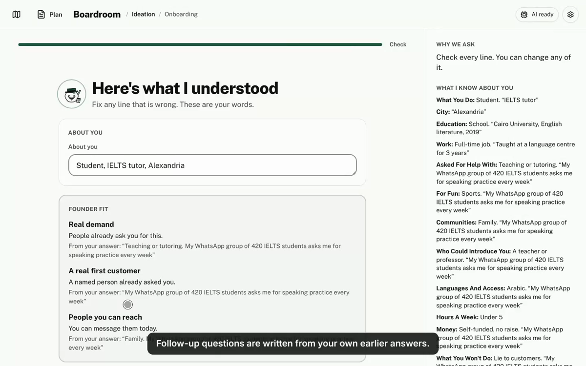

# Boardroom

An open-source AI co-founder team that builds the founder as much as the business. It learns who the founder is first, plays to their strengths, and takes an idea through six gated phases toward a tested, sellable digital product. The founder makes every decision, and the system says **stop** when the evidence is weak. It runs free on a local open-weight model.


**How a run goes:** you answer short questions about your work, studies, groups and limits. You check the profile it built. A research intern finds problems with sources, a boss agent checks every draft, and at each gate you pick an option and say why in your own words. A bare "yes" never counts. Targets are set before each test, and weak results get a plain stop.

## Quickstart

```bash
docker compose up
```

Open http://localhost:3000. The first start downloads the local model, which takes a few minutes. Answer the onboarding questions (type, or use the mic button), then follow the co-founder through each gate. The Map and Plan buttons at the top are always there.

### How to use it

1. **Pick a model.** Click the model button (top right). Local models are free and private; a free hosted key works if your laptop is small.
2. **Answer the onboarding.** About 16 short screens, and you can skip any. Then check "Here's what I understood" and fix any line.
3. **Follow the run.** Answer the co-founder's questions. At each gate, pick an option and explain why.
4. **Watch the evidence.** Sources sit in the right panel with a trust level. Anything unsourced says `ASSUMPTION`.
5. **Open the Plan** any time for the full business plan, open issues and version history.



Without Docker: `pip install -r requirements-dev.txt`, then `python3 -m api.cli --brief briefs/strong.md` runs the pipeline in the terminal.

## What works and what is mocked

Statuses are updated only after a real run. Working = tested end to end. MOCKED = simulated on purpose. STUBBED = designed, minimal output only.

| Phase | Step | Status |
|---|---|---|
| 1 Discover | Founder intake and profile | Working |
| 1 Discover | Find opportunities (research intern + boss) | Working |
| 1 Discover | Customer interview script | Working |
| 1 Discover | Gate: founder picks an option and explains why | Working |
| 2 Validate | Lean Canvas (boss stops the run when boxes are unsourced) | Working |
| 2 Validate | Sign-up page draft (seen in live runs, not in the committed demo run) | Working |
| 2 Validate | Publish sign-up page to Netlify (founder's own free account; code and tests only, never run against Netlify) | STUBBED |
| 2 Validate | Sign-up target gate (recommends stop under 30% of the target; seen in live runs, not in the committed demo run) | Working |
| 2 Validate | Shark panel (SIMULATION) | STUBBED |
| 3 Build | User stories and MVP spec | STUBBED |
| 4 Commercial setup | Pricing and draft policies | STUBBED |
| 5 Launch | Store page and launch posts | STUBBED |
| 5 Launch | Payment and automatic delivery (simulated events, access token, refunds, reconcile; no real money) | MOCKED |
| 6 Operate | Support, metrics, pivot memo | STUBBED |
| All | Founder approval enforced in code (no bare yes, option plus reason) | Working |
| All | Guardrail, ethics check and decision log | Working |
| All | Judges panel | STUBBED |
| Web | Voice input (speech to text in the chat box and onboarding; built and unit-tested, not yet tried with a real microphone) | STUBBED |
| All | Text to speech and voice in the Python pipeline | STUBBED |

## Architecture

A fixed workflow in plain Python runs the six phases. Each step is done by small agents: an intern drafts, a strict boss checks, and judges and an ethics bot review every step. Every model reply is JSON checked against a schema, and every agent action is appended to `decision_log.json`. A gate ends each step: the founder chooses between options and explains why, and the gate code compares results to targets set in advance. Full design: [ARCHITECTURE.md](ARCHITECTURE.md).

## Models and free resources

- Model: `qwen3:8b` via Ollama (open weights) by default, `gpt-oss:20b` as the stronger choice; the founder picks per run, and the other one is used automatically if the first is missing.
- No GPU or Ollama? Use a free OpenAI-compatible tier with your own key (Groq or OpenRouter). The committed demo run used `nvidia/nemotron-3.5-lightning:free` (open weights) on OpenRouter's free tier.
- Web search: a local SearXNG container, no API key.
- Voice input (web, implemented): a mic button in the chat box and on onboarding free-text answers, in English or Arabic. It records with MediaRecorder and runs open-weight Whisper (`onnx-community/whisper-base`) in the browser through [transformers.js](https://github.com/huggingface/transformers.js) (Apache-2.0), on WebGPU when available and WASM otherwise. The model downloads on first use (with a progress note) and no audio leaves the device. If recording is not available, it falls back to the browser's own speech service (Web Speech API), which is labelled in the UI and may send audio to the browser vendor. The text lands in the box for the founder to edit; nothing is sent automatically.
- Voice, not built yet: Kokoro-82M (Apache-2.0) text to speech and a server-side faster-whisper path.
- No paid service is needed. Payments are mocked; nothing is charged.

## Cost per run

About $0.00 per run (local model or free tier, about 119k tokens for the committed Phase 1 to 2 demo run; 56k to 85k tokens in other live runs). Tokens are logged per model call in `decision_log.json`.

## Demo video

Link added after recording (3 minutes or less).

## What our system will NOT do

- Promise income or success.
- Write fake reviews, testimonials, sign-ups, or countdown timers.
- Pretend to be the founder, a customer, or another brand.
- Hold, move, or refund money; create accounts; store passwords or card numbers.
- Publish, send, spend, or sign anything without the founder's approval in the app.
- Accept a bare "yes" as a decision.
- Help build physical goods, financial, investment or crypto products, or health or legal advice products.
- Lock core features behind a paywall.
- Run on the open internet. The app has no log-in. It is local-only and not meant to be exposed to the internet.

## How the project stays alive after the hackathon

- **Maintainers:** the founding team, listed in `MAINTAINERS.md`.
- **Roadmap:** see the Roadmap section of [ARCHITECTURE.md](ARCHITECTURE.md). First: finish Phases 3–6, add Arabic voice, add more founder lessons.
- **Community:** MIT license. Prompts, templates, and the knowledge base are plain markdown, so non-coders can contribute.
- **Funding:** open-source grants and sponsorships. Every core feature stays free.

### Contributing

- **Run the tests:** `python3 -m pytest -q tests` and `cd web && npx vitest run`. New work starts with a failing test.
- **Change an agent:** prompts are plain markdown in `prompts/`; the code that calls them is in `api/agents/`.
- **Add knowledge:** notes go in `kb/`, one claim per line, each with a source link or the word `ASSUMPTION`.
- **Add a trick prompt:** add a row to `evals/trick_prompts.md`; the guardrail test runs every row.
- **Commits:** conventional commits (`feat:`, `fix:`, `test:`, `docs:`), small and focused.
